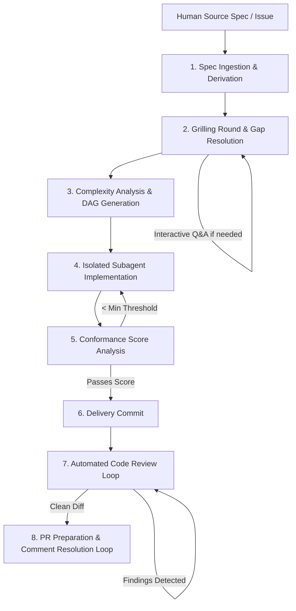

# Spec-Driven Workflow (SDW)

[](https://github.com/jpolvora/spec-driven-workflow/actions/workflows/agentic-code-review.yml)

A streamlined, deterministic framework for spec-driven software development with AI coding agents.

By default, an SDW agent **investigates and proposes a plan before changing anything**; unattended execution happens only through an explicitly invoked skill or command. The full interaction protocol lives in [GLOSSARY.md](GLOSSARY.md) and [`skills/sdw-rules/references/interaction_modes.md`](skills/sdw-rules/references/interaction_modes.md).

---

## 1. Overview & Motivation

**Spec-Driven Workflow (SDW)** is a modern reimagining and simplification of the `workflow-skills` framework.

### Why the Rework?
- **Smarter Frontier Models:** Modern LLMs possess advanced reasoning, tool calling, and architecture comprehension out of the box. They no longer require excessive boilerplate instructions, micro-managed prompts, or multi-page rule books.
- **Speed & Token Efficiency:** Eliminating prompt sediment drastically decreases token load per turn, lowers inference costs, minimizes API latency, and preserves precious context window space for actual project code.
- **Repeatable Predictability:** Rather than relying on fragile prompt suggestions, SDW relies on deterministic Node.js tool anchors, structured state-machine transitions, and empirical verification gates.

SDW standardizes how developers specify, refine, implement, review, and ship features across both local workspaces and remote trackers (GitHub, Azure DevOps).

> 📖 **Feature Showcase:** For an in-depth, presentation-style breakdown of all implemented capabilities, subsystems, and the product roadmap, see [FEATURES.md](FEATURES.md).
> 📚 **Vocabulary:** SDW is opinionated about words. Terms such as **spec**, **backlog**, **task**, **gate**, and **sandbox** are defined in [GLOSSARY.md](GLOSSARY.md) and take precedence over industry synonyms.

---

## 2. The Core Workflow Orchestrator: `sdw-orch`

At the center of SDW is the **`sdw-orch`** orchestrator skill. It coordinates the feature delivery lifecycle end-to-end, managing a dedicated run state file (`.sdw/state/{runId}.state.json`) that enables pause, inspection, resume, and seamless data handoffs across subagents.



### End-to-End Workflow Stages

1. **Spec Ingestion & Agentic Derivation**
   - Ingests human-friendly requirements from local files or remote issue trackers (GitHub Issues, Azure DevOps Work Items).
   - Translates human goals into clear, technical, agentic specifications.
   - *Optimization:* This step is automatically skipped if the input specification is already formatted for agentic execution.

2. **Refinement Round (Grilling + Technical Planning)**
   - Executes an exhaustive decision tree walk over the spec to detect underspecified logic, unhandled edge cases, and missing constraints.
   - Proactively queries project context, codebase structure, memory, and architectural rules to resolve gaps autonomously.
   - Generates a structured technical blueprint (`targetFiles`, `architecturalApproach`, `testPlan`) and persists the human-auditable refinement artifact `{slug}-step-2.md`.
   - For decisions requiring human authority in interactive mode, prompts the user (`ask_question`) with recommended defaults.

3. **Complexity Analysis & DAG Task Decomposition**
   - Assesses technical scope, dependencies, and risk factors, directly ingesting the Step 2 technical blueprint.
   - Generates a Directed Acyclic Graph (DAG) dividing the work into discrete, atomic execution units with context prompts.
   - Resolves target files only from what the specification names or declares new, or from a known real-file bucket that exists; it never invents a path from the slug.
   - Persists the DAG plan artifact `{slug}-step-3.md`. Supports isolated git worktrees (`useWorktrees: true`) for multi-task plans.

4. **Sequential Subagent Dispatch & Evidence Gate**
   - Dispatches exactly one DAG task at a time: `task next` emits a self-sufficient brief (verbatim criteria, scope fence, prohibitions, dependency context, honest evidence template, report contract) and the host agent runs one worker per envelope. `command` mode instead runs a configured subprocess per task with token substitution and environment sanitization.
   - Enforces single-flight ordering — a second dispatch, or a `task finish` for any task but the dispatched one, is rejected — and releases a lost worker's task with `task abandon --reason`.
   - Corroborates each task against a baseline captured at dispatch (dirty paths plus content hashes), so edits inherited from an earlier task never satisfy the evidence gate. `command` mode still isolates multi-task plans in sequential git worktrees branching from primary `HEAD`.
   - Requires task completion via `sdw-orch task finish` with schema-validated evidence, including a required `status` where only `success` is accepted.
   - Executes build and test verification gates (`verification.buildCommand`, `verification.testCommand`) once all tasks are accepted.

5. **LLM-Judge Conformance Scoring**
   - Delegates scoring to an LLM judge fenced to the acceptance criteria plus the generated diff, excluding transcripts and evidence claims.
   - Accepts a configured judge (`scoring.judgeCommand`, model/provider/effort/endpoint hints) or defaults to the current agent model, which submits its verdict through `score submit` after Step 5 pauses with exit code 5.
   - Derives the score from per-criterion verdicts (`round(verified / total * 10)`), applies the configurable criticity rubric, and fails closed on zero criteria, an unavailable judge, or a malformed verdict.
   - Persists the scoring artifact `{slug}-step-5.md` with per-criterion verdicts and evidence references.
   - If the score falls below the required threshold (default `< 8/10`), triggers a feedback re-implementation loop (code 2).

6. **Delivery Commit & Quality Guard**
   - Refuses delivery commits if Step 4 is incomplete, any task unaccepted, or any verification gate failed.
   - Runs pre-commit secret leak scan (`sdw-security-checks`) when enabled.
   - Creates an atomic, structured delivery git commit (`feat(...)`).

7. **Automated Code Review Loop (Delegated to `sdw-code-review`)**
   - Dispatches `sdw-code-review` to inspect working-tree and branch diffs against the configured integration lane (`branching.integrationBranch`) or an auto-detected base branch.
   - Evaluates `sdw-rules` simplicity, surgical diff hygiene, and syntax invariants.
   - Generates an actionable Markdown fix plan (`{slug}-step-7.md`) and applies surgical fixes in an iterative loop.

8. **PR Preparation, Delivery & Review Convergence (Delegated to `sdw-ship-pr`)**
   - Delegates pre-PR verification gates (`requiredBuild`, `runAllTests`, `prePrCommand`, `prePrInstructions`) and delivery publishing to `sdw-ship-pr`.
   - Targets the pull request base at `branching.integrationBranch`, so Git Flow, GitHub flow, and trunk repositories merge into their own integration lane.
   - Executes cooperative and proactive review convergence with push-before-resolve guarantees, posting structured resolution comments before closing threads.
   - Delegates active review findings to `sdw-fixer` when `reviewFixCommand` is unset, and reports `review_pending` when the fixer returns no applied fix.
   - Optionally merges the converged pull request with `--merge` / `--allow-merge` (fire and forget: a merge failure is recorded but never fails the delivery). After an observed merge, `branching.syncWorkBranchAfterMerge` fast-forwards the work lane to the integration lane and `branching.pushSyncedWorkBranch` pushes it; a dirty tree or a non-fast-forward leaves every local branch untouched and records `branchingSync.status: "blocked"`.
   - Updates the specification index to `completed` and records PR metadata, the resolved `branching` lanes, and the `branchingSync` outcome in the run state.

---

## 3. Repository Architecture

```text
spec-driven-workflow/
├── bin/                          # Repository tooling (local review dry run)
│   └── review-dry-run.cjs        # Pinned OpenCode 1.19.1 + agentic-code-reviewers
├── .github/                      # GitHub Actions automation & CI/CD
│   ├── workflows/                # Continuous integration, code review, and release pipelines
│   │   ├── ci.yml
│   │   ├── agentic-code-review.yml
│   │   └── release.yml
│   ├── agentic-code-reviewers-prompt.md # SDW review contract for agentic reviewers
│   └── README.md                 # GitHub integration documentation
├── .sdw/                         # Canonical template for consumer projects
│   ├── config.json               # Default configuration schema
│   ├── directory-structure.md    # Layout rules & documentation
│   └── specs/                    # Storage directory for feature specifications
│       ├── index.specs.md        # Central specification index
│       └── *.md                  # Canonical feature specifications
│   ├── state/                    # Ephemeral execution run state and step artifacts
│   │   └── {slug}/{runId}/       # Human-auditable step artifacts ({slug}-step-{N}.md)
│   ├── memory/                   # Product knowledge entries (versioned)
│   │   └── traps.md              # Central anti-regression trap log
│   └── worktrees/                # Ephemeral per-task git worktrees for isolated subagents
├── skills/                       # Canonical source of truth for all skills
│   ├── sdw-batch/                # Multi-spec queue delegating to single sdw-orch runs
│   ├── sdw-code-review/          # Standalone deep working-tree review & fix planning
│   ├── sdw-config/               # Project configuration & verification skill
│   ├── sdw-doctor/               # Installation & workspace health checker
│   ├── sdw-fixer/                # Shared findings intake, scoring & surgical remediation
│   ├── sdw-memory/               # Central knowledge wrapper (query, record, consolidate, classify)
│   ├── sdw-orch/                 # End-to-end workflow orchestrator skill
│   ├── sdw-router/               # Always-autoloaded entrypoint and skill router
│   ├── sdw-rules/                # Shared behavioral rules, simplicity & anti-overengineering
│   ├── sdw-security-checks/      # Pre-commit secrets and credentials leak scanner
│   ├── sdw-ship-pr/              # Standalone PR shipping & review convergence skill
│   └── sdw-spec/                 # Spec authoring, validation, sync, and index manager
├── tests/                        # Automated unit & integration test suites
│   ├── sdw_branch_sync.test.cjs
│   ├── sdw_branch_worktree.test.cjs
│   ├── sdw_code_review.test.cjs
│   ├── sdw_config.test.cjs
│   ├── sdw_github_actions.test.cjs
│   ├── sdw_orch.test.cjs
│   ├── sdw_orch_implementation.test.cjs
│   ├── sdw_refinement_gates.test.cjs
│   ├── sdw_router.test.cjs
│   ├── sdw_rules.test.cjs
│   ├── sdw_scm_provider.test.cjs
│   ├── sdw_security_checks.test.cjs
│   ├── sdw_ship_pr.test.cjs
│   ├── sdw_spec.test.cjs
│   └── sdw_step_artifacts.test.cjs
├── AGENTS.md                     # Mandatory rules and protocols for AI agents
├── FEATURES.md                   # Feature showcase and architecture presentation
└── README.md                     # Project documentation and architecture guide
```

### Key Principles

- **`skills/` as Source of Truth:** Skills in development live in `skills/`. When packaged or installed into consumer repositories, they target `{projectRoot}/.agents/skills/`.
- **Zero Heavy Dependencies:** All runtime skill scripts are lightweight **Node.js 22 CommonJS (`.cjs`)** using only Node standard library (`fs`, `path`, `process`, `child_process`). No npm installation overhead or external runtime dependencies.
- **Portability:** Path resolution automatically supports Windows and POSIX environments with forward-slash normalization.

---

## 4. Installing Skills with `npx skills` (Consumers)

Install the SDW skills into any consumer project using the open agent skills tool (`npx skills`, see [vercel-labs/skills](https://github.com/vercel-labs/skills) / [skills.sh](https://skills.sh)). Run from your project root. Requires **Node.js 22.20 or later**.

Verify what is available before installing:

```bash
npx skills add jpolvora/spec-driven-workflow --list
```

Expected: `12` discoverable skills — the 11 `sdw-*` skills plus `ws-memo`:

| Skill | Purpose |
|---|---|
| `sdw-router` | Always-autoloaded router, dispatches prompts to the right SDW skill |
| `sdw-config` | Initializes and verifies the `.sdw/` workspace (`init`, `check`, `parse`) |
| `sdw-doctor` | Installation and workspace health checker (upstream, local, global, hybrid) |
| `sdw-spec` | Spec authoring, grilling, EARS validation, index sync |
| `sdw-orch` | End-to-end 8-step delivery workflow for one specification (spec → DAG → implement → review → PR) |
| `sdw-batch` | Queues multiple specifications and delegates each one to `sdw-orch` as a single run |
| `sdw-rules` | Shared simplicity / anti-overengineering rules |
| `sdw-security-checks` | Pre-commit secrets and credentials leak gate |
| `sdw-code-review` | Standalone working-tree review and fix planning (also Step 7 delegation) |
| `sdw-fixer` | Shared findings intake, deterministic scoring, surgical remediation (review and ship loops) |
| `sdw-memory` | Central knowledge wrapper: query, record, consolidate, classify traps, gaps, patterns, errors |
| `sdw-ship-pr` | Pre-PR checks, branch push, PR creation, review convergence |

### Copy-paste: install all SDW skills (recommended)

```bash
npx skills add jpolvora/spec-driven-workflow --skill sdw-router --skill sdw-config --skill sdw-doctor --skill sdw-spec --skill sdw-orch --skill sdw-batch --skill sdw-rules --skill sdw-security-checks --skill sdw-code-review --skill sdw-fixer --skill sdw-memory --skill sdw-ship-pr -y
```

One-liner alternative (installs everything discoverable, including `ws-memo`):

```bash
npx skills add jpolvora/spec-driven-workflow --all
```

Interactive install (pick skills and agents from a menu):

```bash
npx skills add jpolvora/spec-driven-workflow
```

### Scope, agents, and lifecycle

```bash
# Project scope (default): installs to ./.agents/skills/, commit with your project
# Global scope: available across all projects on the machine
npx skills add jpolvora/spec-driven-workflow --skill sdw-router --skill sdw-config --skill sdw-doctor --skill sdw-spec --skill sdw-orch --skill sdw-batch --skill sdw-rules --skill sdw-security-checks --skill sdw-code-review --skill sdw-fixer --skill sdw-memory --skill sdw-ship-pr -g -y

# Target specific agents (default is auto-detected agents; use '*' for all agents)
npx skills add jpolvora/spec-driven-workflow --skill sdw-orch -a opencode -y
npx skills add jpolvora/spec-driven-workflow --skill sdw-orch --skill sdw-spec -a claude-code -a cursor -y

# Verify, update, remove
npx skills list
npx skills check
npx skills update
npx skills remove sdw-orch
```

### Global install (`$HOME/.agents/skills`)

Global-only install — user-level (`$HOME/.agents/skills`) instead of project (`./.agents/skills`), cwd-independent:

```bash
npx skills add jpolvora/spec-driven-workflow -g --all
```

- `-g`: installs globally (user-level) instead of project-level.
- `--all`: shorthand for `-s '*' -a '*' -y` (all skills, all agents, no prompts), same as the project test but global.
- Subset (global, non-interactive):

```bash
npx skills add jpolvora/spec-driven-workflow -g -s sdw-spec,sdw-orch -y
```

- Verify:

```bash
npx skills list -g
```

Installed layout (project scope under `<projectRoot>/.agents/skills/`, global scope under `$HOME/.agents/skills/`; OpenCode / Cursor / Codex share `.agents/skills/`; Claude Code also links under `.claude/skills/`):

```text
<projectRoot>/.agents/skills/sdw-orch/SKILL.md
<projectRoot>/.agents/skills/sdw-spec/SKILL.md
...
<projectRoot>/skills-lock.json
# global equivalent: $HOME/.agents/skills/sdw-orch/SKILL.md, ...
```

### After install: initialize the workspace

```bash
# Initialize .sdw/ structure in the consumer project
node .agents/skills/sdw-config/scripts/sdw_config.cjs init

# Verify installation and workspace health
node .agents/skills/sdw-config/scripts/sdw_config.cjs check
node .agents/skills/sdw-router/scripts/sdw_router.cjs scan
node .agents/skills/sdw-doctor/scripts/sdw_doctor.cjs check
```

> Note: contributor docs in this repo use canonical paths (`node skills/<name>/scripts/*.cjs`). Consumers installed via `npx skills` use the same script names under `node .agents/skills/<name>/scripts/*.cjs`.

---

## 5. Getting Started

### Using `sdw-router` (Autoload & Routing)

The `sdw-router` skill is an always-applied router that inspects prompts and dispatches to specialized skills:

```bash
# Analyze prompt intent or explicit invocations (/sdw-*)
node skills/sdw-router/scripts/sdw_router.cjs route "<prompt>" [--json]

# Scan available skills across canonical (skills/) and consumer (.agents/skills/) paths
node skills/sdw-router/scripts/sdw_router.cjs scan [--json]

# Audit skills integrity and directory health
node skills/sdw-router/scripts/sdw_router.cjs doctor [--json]
```

### Using `sdw-config` (Workspace Configuration)

The `sdw-config` skill manages the `.sdw/` workspace infrastructure:

```bash
# Initialize .sdw/ structure in current or target repository
node skills/sdw-config/scripts/sdw_config.cjs init [--root <path>] [--force]

# Verify integrity, syntax, and directory conformance
node skills/sdw-config/scripts/sdw_config.cjs check [--root <path>] [--json]

# Parse configuration and resolve path tokens (e.g. {projectRoot})
node skills/sdw-config/scripts/sdw_config.cjs parse [--root <path>] [--json]
```

### Using `sdw-doctor` (Installation Health)

The `sdw-doctor` skill audits installed skills and the consuming workspace across four modes: `upstream` (this repository), `consumer-local`, `consumer-global`, and `hybrid` (global skills plus a local `.sdw/`):

```bash
# Audit skills, references, scripts, config keys, registry rows, and specs
node skills/sdw-doctor/scripts/sdw_doctor.cjs check

# Structured output for CI
node skills/sdw-doctor/scripts/sdw_doctor.cjs check --json

# End-to-end sandbox smoke test of the installed pipeline
node skills/sdw-doctor/scripts/sdw_doctor.cjs test
```

On any error it prints the matching remediation and stops: `npx skills add ...` / `npx skills update` for a broken or missing installation, `sdw-config init` / `sdw-config check` for configuration gaps, and `sdw-spec sync` / `validate` for specification drift. Upstream mode never suggests `npx`; it points at `node scripts/verify_skills.cjs verify` instead.

### Using `sdw-spec` (Specification Management)

The `sdw-spec` skill manages specification authoring, formatting, grilling, validation, status, and lifecycle:

```bash
# Synthesize a new specification from free-text requirements (header status: draft)
node skills/sdw-spec/scripts/sdw_spec.cjs new "<requirements>"

# Validate specification formatting and EARS syntax readiness
node skills/sdw-spec/scripts/validate_spec.cjs --mode=authoring .sdw/specs/<spec-name>.md

# Move the header status through the defined transitions
node skills/sdw-spec/scripts/sdw_spec.cjs status <slug> awaiting-approval

# Reconcile index.specs.md with active on-disk specifications and run states
node skills/sdw-spec/scripts/sdw_spec.cjs sync

# List all specifications and their validation health
node skills/sdw-spec/scripts/sdw_spec.cjs list
```

Grilling is the optional round-based interview that closes spec gaps before implementation; when a draft spans several domains, `sdw-spec` recommends splitting it by feature first. Protocol: `skills/sdw-spec/references/grilling.md`.

### Using `sdw-orch` (Workflow Orchestrator)

The `sdw-orch` skill executes the end-to-end 8-step delivery workflow:

```bash
# Execute the full delivery pipeline for a specification
node skills/sdw-orch/scripts/sdw_orch.cjs run .sdw/specs/<spec-name>.md [--push]

# Queue several specifications; each one runs as its own single-spec pipeline
node skills/sdw-batch/scripts/sdw_batch.cjs run <spec1.md> <spec2.md> ... [--continue-on-error]

# Validate a spec and print the execution plan without executing anything
node skills/sdw-orch/scripts/sdw_orch.cjs run .sdw/specs/<spec-name>.md --dry-run

# Refine an already delivered spec: fill gaps/drift, simplify, report, commit only on change
node skills/sdw-orch/scripts/sdw_orch.cjs run .sdw/specs/<spec-name>.md --second-pass

# Execute the whole pipeline in an isolated local clone (no push, no PR)
node skills/sdw-orch/scripts/sdw_orch.cjs run .sdw/specs/<spec-name>.md --sandbox
node skills/sdw-orch/scripts/sdw_orch.cjs sandbox list
node skills/sdw-orch/scripts/sdw_orch.cjs sandbox report --run-id <runId>
node skills/sdw-orch/scripts/sdw_orch.cjs sandbox clean --run-id <runId>

# Resume an interrupted single-spec run
node skills/sdw-orch/scripts/sdw_orch.cjs resume [--run-id <runId>]

# Inspect status of active execution
node skills/sdw-orch/scripts/sdw_orch.cjs status
```

Skill-level aliases `sdw-orch implement`, `orch run`, and `orch implement` resolve to the same pipeline through `sdw-router`; `run` stays the canonical CLI subcommand.

### Using `sdw-batch` (Specification Queue)

`sdw-batch` is a loop around the single-spec pipeline. Each queued specification runs through the complete `sdw-orch` lifecycle (implementation, scoring, delivery commit, review, PR, convergence) before the next one starts:

```bash
# Queue specifications; each runs as an independent single-spec pipeline
node skills/sdw-batch/scripts/sdw_batch.cjs run <spec1.md> <spec2.md> ... [--continue-on-error]

# Resume a paused queue from its first non-completed item (same run, never restarted)
node skills/sdw-batch/scripts/sdw_batch.cjs resume [batchId]

# Inspect queue progress
node skills/sdw-batch/scripts/sdw_batch.cjs status [batchId]
```

Queue state lives in `.sdw/state/batch-{batchId}.json`. Dispatch (`4`) and judgment (`5`) pauses stop the loop; the host agent drives the paused run and then resumes the queue. Specifications already recorded as `completed` or `archived` in `index.specs.md` are skipped, so a queue never re-implements delivered work.

A batch never refines a delivered specification. Refinement is an explicit single-spec call: `sdw-orch run <spec> --second-pass` (alias `--refine`) audits what was delivered, fills acceptance criteria that are missing or drifted from the spec, applies clear simplifications, always writes a `{slug}-refine.md` report, commits only when the pass changed code, and reaches `sdw-ship-pr` only when that commit exists.

### Using `sdw-security-checks` (Secrets & Credentials Gate)

The `sdw-security-checks` skill guards against committing sensitive tokens and credentials:

```bash
# Scan working tree (ignore-aware) for secrets and leaks
node skills/sdw-security-checks/scripts/sdw_security_checks.cjs scan

# Scan staged changes only (git diff --cached)
node skills/sdw-security-checks/scripts/sdw_security_checks.cjs scan --staged

# Emit structured JSON report
node skills/sdw-security-checks/scripts/sdw_security_checks.cjs scan --staged --json
```

### Using `sdw-ship-pr` (PR Shipping & Review Convergence)

The `sdw-ship-pr` skill executes pre-PR verification, publishes branches, creates/reuses PRs, and runs automated review convergence. The pull request base resolves from `branching.integrationBranch` (explicit `--base` still wins), and a merged pull request can fast-forward and optionally push the work lane:

```bash
# Execute standalone PR shipping with pre-PR verification
node skills/sdw-ship-pr/scripts/sdw_ship_pr.cjs --head <branch> --base <baseBranch>

# Resolve the PR base from branching.integrationBranch
node skills/sdw-ship-pr/scripts/sdw_ship_pr.cjs --head <branch> --merge

# Dry-run simulation without git push or remote mutations
node skills/sdw-ship-pr/scripts/sdw_ship_pr.cjs --head develop --dry-run --json

# Ship and run review convergence loop with resolution summary comments
node skills/sdw-ship-pr/scripts/sdw_ship_pr.cjs --head develop --push --poll-pr
```

### Using `sdw-code-review` (Deep Review & Fix Planning)

The `sdw-code-review` skill deeply analyzes committed and uncommitted working-tree changes against an auto-detected base branch, and doubles as the `sdw-orch` Step 7 delegation target:

```bash
# Review working tree and HEAD diffs (auto-detected base), write Markdown fix plan
node skills/sdw-code-review/scripts/sdw_code_review.cjs run

# Review with surgical auto-fixes (up to 3 iterations) and JSON output
node skills/sdw-code-review/scripts/sdw_code_review.cjs fix --json

# Simulate fixes without modifying files
node skills/sdw-code-review/scripts/sdw_code_review.cjs run --fix --dry-run --json
```

### Using `sdw-fixer` (Shared Findings Remediation)

The `sdw-fixer` skill is the single remediation authority for review, verification, and ship loops. It validates one findings batch, scores it deterministically, consults defect-class knowledge through the central `sdw-memory` wrapper, applies surgical edits, and reports what it fixed, skipped, and learned:

```bash
# Validate, score, and apply a findings batch; write the structured report
node skills/sdw-fixer/scripts/sdw_fixer.cjs run --findings findings.json --report result.json

# Plan the same batch without touching files
node skills/sdw-fixer/scripts/sdw_fixer.cjs run --findings findings.json --report result.json --dry-run --json

# Validate skill layout, references, and the zero-dependency guarantee
node skills/sdw-fixer/scripts/sdw_fixer.cjs doctor --json
```

Findings use `{ file, line, rule, evidence, severityHint }` with project-relative paths. `sdw-ship-pr` builds this batch from active review threads and delegates automatically when `reviewFixCommand` is unset; `--no-learn` skips trap registration, and `SDW_FIXER_NO_MEMO=1` skips vault queries. All knowledge reads and writes go through `sdw-memory`. Contract: `skills/sdw-fixer/references/fixer_protocol.md`.

### Using `sdw-memory` (Central Knowledge Wrapper)

The `sdw-memory` skill is the single contract for product knowledge. It classifies entries as `trap`, `gap`, `pattern`, or `error`, queries every enabled backend, records verified learnings, and consolidates duplicates:

```bash
# Classify free text before writing (suggests kind, slug, tags, layer)
node skills/sdw-memory/scripts/sdw_memory.cjs classify "commit failed because state gates were stale"

# Query the vault first, then the local traps file, capped hints
node skills/sdw-memory/scripts/sdw_memory.cjs query "gate repair" --kind trap --limit 5 --json

# Record one verified learning (duplicate slugs are refused)
node skills/sdw-memory/scripts/sdw_memory.cjs record --kind trap --title "..." --avoid "..." --action "..."

# Merge duplicate local rows; vault records are reported, never deleted
node skills/sdw-memory/scripts/sdw_memory.cjs consolidate --dry-run --json
```

Backends are pluggable: `--backend auto` uses the `ws-memo` vault when the `memo` CLI is reachable (`SDW_MEMORY_NO_MEMO=1` opts out) and falls back to `.sdw/memory/traps.md` offline; `all` writes both on record. Select backends per user in `.sdw/config.json` via `memory.backends: { wsMemo, traps, files }`. Contract: `skills/sdw-memory/references/memory_protocol.md`.

### Local Agentic Code Review Dry Run

Runs the same `agentic-code-reviewers` recipe as CI against the current branch (`develop` → `master`) without publishing PR threads:

```bash
npm install          # installs the pinned opencode-ai@1.19.1 dev dependency
npm run review:dry   # alias: npm run review
```

The helper uses the `OPENCODE_API_KEY` from the OS environment through the `opencode-go` provider, forces the pinned OpenCode `1.19.1` binary, and passes `--dry-run` with the Custom stack prompt. Findings are printed as `::error` / `::warning` annotations and the command exits `0` even when issues are found. See [AGENTS.md](AGENTS.md#10-local-code-review-dry-run-agentic-code-reviewers) for overrides.

## 6. License & Contribution

Maintained under the Spec-Driven Workflow initiative. Contributions must adhere to the authoring guidelines documented in [AGENTS.md](AGENTS.md).
