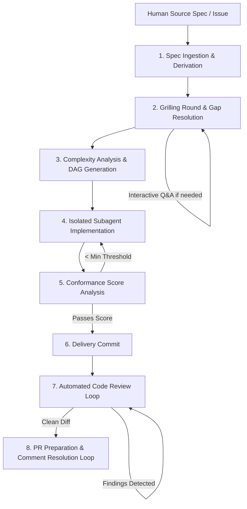

# Spec-Driven Workflow (SDW)

A streamlined, deterministic framework for spec-driven software development with AI coding agents.

---

## 1. Overview & Motivation

**Spec-Driven Workflow (SDW)** is a modern reimagining and simplification of the `workflow-skills` framework.

### Why the Rework?
- **Smarter Frontier Models:** Modern LLMs possess advanced reasoning, tool calling, and architecture comprehension out of the box. They no longer require excessive boilerplate instructions, micro-managed prompts, or multi-page rule books.
- **Speed & Token Efficiency:** Eliminating prompt sediment drastically decreases token load per turn, lowers inference costs, minimizes API latency, and preserves precious context window space for actual project code.
- **Repeatable Predictability:** Rather than relying on fragile prompt suggestions, SDW relies on deterministic Node.js tool anchors, structured state-machine transitions, and empirical verification gates.

SDW standardizes how developers specify, refine, implement, review, and ship features across both local workspaces and remote trackers (GitHub, Azure DevOps).

> 📖 **Feature Showcase:** For an in-depth, presentation-style breakdown of all implemented capabilities, subsystems, and the product roadmap, see [FEATURES.md](FEATURES.md).

---

## 2. The Core Workflow Orchestrator: `sdw-orch`

At the center of SDW is the **`sdw-orch`** orchestrator skill. It coordinates the feature delivery lifecycle end-to-end, managing a dedicated run state file (`.sdw/state/{runId}.state.json`) that enables pause, inspection, resume, and seamless data handoffs across subagents.



### End-to-End Workflow Stages

1. **Spec Ingestion & Agentic Derivation**
   - Ingests human-friendly requirements from local files or remote issue trackers (GitHub Issues, Azure DevOps Work Items).
   - Translates human goals into clear, technical, agentic specifications.
   - *Optimization:* This step is automatically skipped if the input specification is already formatted for agentic execution.

2. **Refinement Round (Grilling + Technical Planning)**
   - Executes an exhaustive decision tree walk over the spec to detect underspecified logic, unhandled edge cases, and missing constraints.
   - Proactively queries project context, codebase structure, memory, and architectural rules to resolve gaps autonomously.
   - Generates a structured technical blueprint (`targetFiles`, `architecturalApproach`, `testPlan`) and persists the human-auditable refinement artifact `{slug}-step-2.md`.
   - For decisions requiring human authority in interactive mode, prompts the user (`ask_question`) with recommended defaults.

3. **Complexity Analysis & DAG Task Decomposition**
   - Assesses technical scope, dependencies, and risk factors, directly ingesting the Step 2 technical blueprint.
   - Generates a Directed Acyclic Graph (DAG) dividing the work into discrete, atomic execution units with context prompts.
   - Persists the DAG plan artifact `{slug}-step-3.md`. Supports isolated git worktrees (`useWorktrees: true`) for multi-task plans.

4. **Isolated Subagent Dispatch & Implementation**
   - Dispatches focused subagents according to the DAG definition.
   - Enforces context fencing: each subagent receives only the relevant task prompt and scoped references, preventing context pollution and keeping the model tightly focused on its file set.

5. **Conformance Scoring Loop**
   - Evaluates implementation output by quantitatively comparing the resulting diffs and touched files against the refined spec's acceptance criteria.
   - Persists the preliminary implementation report artifact `{slug}-step-5.md` with verified criteria and conformance score breakdown.
   - If the score falls below the required threshold (e.g. `< 8/10`), loops back with gap observations.

6. **Delivery Commit**
   - Once quality is assured by the conformance score, creates an atomic, structured delivery git commit.

7. **Automated Code Review Loop**
   - Compares the newly committed code against the base branch commit.
   - Evaluates project-specific coding standards, architectural invariants, security risks, and regressions.
   - If warnings or findings are reported, applies targeted surgical fixes and creates updated commits in an iterative loop until all findings are resolved.

8. **Pre-PR Quality Gates, PR Preparation & Remote Review Resolution Loop**
   - Runs opt-in build verification (`requiredBuild`, `buildCommand`) and full test execution pass (`runAllTests`, `testCommand`) with an automated surgical fix loop (up to 3 attempts) and secret leak scanning.
   - Executes optional project-specific pre-PR commands (`prePrCommand`) and instructions (`prePrInstructions`).
   - Marks the feature spec as completed, assembles PR metadata, and pushes to remote origin when `--push` is enabled.

---

## 3. Repository Architecture

```text
spec-driven-workflow/
├── .sdw/                         # Canonical template for consumer projects
│   ├── config.json               # Default configuration schema
│   ├── directory-structure.md    # Layout rules & documentation
│   └── specs/                    # Storage directory for feature specifications
│       ├── index.specs.md        # Central specification index
│       └── *.md                  # Canonical feature specifications
│   ├── state/                    # Ephemeral execution run state and step artifacts
│   │   └── {slug}/{runId}/       # Human-auditable step artifacts ({slug}-step-{N}.md)
│   ├── traps.md                  # Central anti-regression trap log
│   └── worktrees/                # Ephemeral per-task git worktrees for isolated subagents
├── skills/                       # Canonical source of truth for all skills
│   ├── sdw-config/               # Project configuration & verification skill
│   ├── sdw-orch/                 # End-to-end workflow orchestrator skill
│   ├── sdw-router/               # Always-autoloaded entrypoint and skill router
│   ├── sdw-rules/                # Shared behavioral rules, simplicity & anti-overengineering
│   ├── sdw-security-checks/      # Pre-commit secrets and credentials leak scanner
│   └── sdw-spec/                 # Spec authoring, validation, sync, and index manager
├── tests/                        # Automated unit & integration test suites
│   ├── sdw_branch_worktree.test.cjs
│   ├── sdw_config.test.cjs
│   ├── sdw_orch.test.cjs
│   ├── sdw_refinement_gates.test.cjs
│   ├── sdw_router.test.cjs
│   ├── sdw_rules.test.cjs
│   ├── sdw_scm_provider.test.cjs
│   ├── sdw_security_checks.test.cjs
│   ├── sdw_spec.test.cjs
│   └── sdw_step_artifacts.test.cjs
├── AGENTS.md                     # Mandatory rules and protocols for AI agents
├── FEATURES.md                   # Feature showcase and architecture presentation
└── README.md                     # Project documentation and architecture guide
```

### Key Principles

- **`skills/` as Source of Truth:** Skills in development live in `skills/`. When packaged or installed into consumer repositories, they target `{projectRoot}/.agents/skills/`.
- **Zero Heavy Dependencies:** All runtime skill scripts are lightweight **Node.js 22 CommonJS (`.cjs`)** using only Node standard library (`fs`, `path`, `process`, `child_process`). No npm installation overhead or external runtime dependencies.
- **Portability:** Path resolution automatically supports Windows and POSIX environments with forward-slash normalization.

---

## 4. Getting Started

### Using `sdw-router` (Autoload & Routing)

The `sdw-router` skill is an always-applied router that inspects prompts and dispatches to specialized skills:

```bash
# Analyze prompt intent or explicit invocations (/sdw-*)
node skills/sdw-router/scripts/sdw_router.cjs route "<prompt>" [--json]

# Scan available skills across canonical (skills/) and consumer (.agents/skills/) paths
node skills/sdw-router/scripts/sdw_router.cjs scan [--json]

# Audit skills integrity and directory health
node skills/sdw-router/scripts/sdw_router.cjs doctor [--json]
```

### Using `sdw-config` (Workspace Configuration)

The `sdw-config` skill manages the `.sdw/` workspace infrastructure:

```bash
# Initialize .sdw/ structure in current or target repository
node skills/sdw-config/scripts/sdw_config.cjs init [--root <path>] [--force]

# Verify integrity, syntax, and directory conformance
node skills/sdw-config/scripts/sdw_config.cjs check [--root <path>] [--json]

# Parse configuration and resolve path tokens (e.g. {projectRoot})
node skills/sdw-config/scripts/sdw_config.cjs parse [--root <path>] [--json]
```

### Using `sdw-spec` (Specification Management)

The `sdw-spec` skill manages specification authoring, formatting, validation, and lifecycle:

```bash
# Synthesize a new specification from free-text requirements
node skills/sdw-spec/scripts/sdw_spec.cjs new "<requirements>"

# Validate specification formatting and EARS syntax readiness
node skills/sdw-spec/scripts/validate_spec.cjs --mode=authoring .sdw/specs/<spec-name>.md

# Reconcile index.specs.md with active on-disk specifications and run states
node skills/sdw-spec/scripts/sdw_spec.cjs sync

# List all specifications and their validation health
node skills/sdw-spec/scripts/sdw_spec.cjs list
```

### Using `sdw-orch` (Workflow Orchestrator)

The `sdw-orch` skill executes the end-to-end 8-step delivery workflow:

```bash
# Execute the full delivery pipeline for a specification
node skills/sdw-orch/scripts/sdw_orch.cjs run .sdw/specs/<spec-name>.md [--push]

# Execute a multi-specification sequential batch queue
node skills/sdw-orch/scripts/sdw_orch.cjs run <spec1.md> <spec2.md> ... [--continue-on-error] [--dry-run]

# Resume an interrupted single-spec run
node skills/sdw-orch/scripts/sdw_orch.cjs resume [--run-id <runId>]

# Resume an interrupted multi-spec batch queue
node skills/sdw-orch/scripts/sdw_orch.cjs resume-batch [batchId]

# Inspect status of active execution
node skills/sdw-orch/scripts/sdw_orch.cjs status
```

### Using `sdw-security-checks` (Secrets & Credentials Gate)

The `sdw-security-checks` skill guards against committing sensitive tokens and credentials:

```bash
# Scan working tree (ignore-aware) for secrets and leaks
node skills/sdw-security-checks/scripts/sdw_security_checks.cjs scan

# Scan staged changes only (git diff --cached)
node skills/sdw-security-checks/scripts/sdw_security_checks.cjs scan --staged

# Emit structured JSON report
node skills/sdw-security-checks/scripts/sdw_security_checks.cjs scan --staged --json
```

## 5. License & Contribution

Maintained under the Spec-Driven Workflow initiative. Contributions must adhere to the authoring guidelines documented in [AGENTS.md](AGENTS.md).
